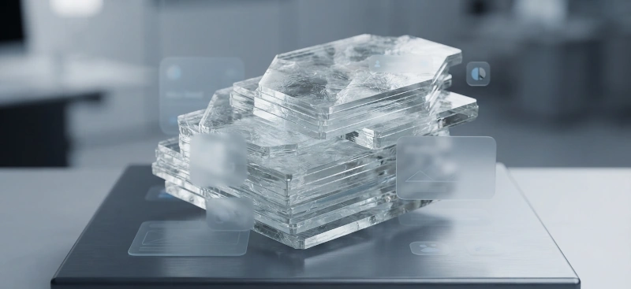

# In-Game UI (Mica)

Rewild draws its in-game UI on the GPU: the HUD bars, the in-game menu, game over, settings and
the personal assistant on the player's wrist. These screens look like the glass panels of the
editor, and they work with a mouse, touch, the keyboard and a gamepad. Because the renderer draws
them, a panel can also stand in the 3D world. This page explains what the GPU UI gives you and how
to use it.

> **Where the name comes from.** _Mica_ is a mineral that splits into thin, clear sheets. It was
> once used as window glass. Mica was the milestone that built this UI. That work is complete. This
> page is now the plain-English guide to what it gives you.

---

## The short version

- **The GPU UI lives in `packages/rewild-gpu-ui`.** It needs only a WebGPU device and a canvas.
  The renderer owns one, as `renderer.ui`.
- **The DOM is still home to most of the UI.** The main menu, project views, the editor and admin
  stay in the DOM. The GPU UI is for what the player uses while they are in the game.
- **A tree of nodes**, built in plain TypeScript. There is no JSX and no CSS.
- **Flex layout**, with style names taken from CSS, such as `flexDirection` and `borderRadius`.
- **Theme colours are shared with the DOM**, so both UIs look like one product, in light and dark.
- **Ready-made components**: buttons, modals, popups, tabs, selects, sliders, switches, meters,
  images, grids and more.
- **Glass, shadows and transitions**, the same as the DOM's glass panels.
- **Every input works the same way**: mouse, touch, keys, gamepad, and a ray from the eye in 3D.
- **Panels can stand in the world** as well as on the screen.
- **The UI inspector** shows each part next to its DOM version, so you can check it by eye.

---

## Where each UI lives

| UI                                         | Lives in |
| ------------------------------------------ | -------- |
| Main menu, auth, project views             | DOM      |
| Editor, admin                              | DOM      |
| HUD: health, hunger, stamina, oxygen, heat | GPU UI   |
| In-game menu, game over                    | GPU UI   |
| Settings, opened from the in-game menu     | GPU UI   |
| The personal assistant                     | GPU UI   |

The main menu's `/settings` route keeps the DOM settings panel. Both settings panels read and write
the same settings, so a change in one shows in the other.

---

## Surfaces and nodes

A **surface** is a layer of UI. It owns one tree of **nodes** and says where the tree draws.

```ts
const hud = renderer.ui.createSurface({ kind: 'screen', name: 'hud', input: 'none' });

const bars = new UINode({
  name: 'bars',
  style: { position: 'absolute', bottom: 24, left: '30%', width: '40%', flexDirection: 'column', gap: 4 },
});
hud.root.append(bars);
```

- **Order.** Surfaces draw from low `order` to high. The HUD is under the menu, and a popup is over
  the menu. Inside a surface, later children draw on top of earlier ones, as on the web.
- **Tree changes.** `append`, `insertBefore`, `remove` and `replaceChildren` work the same as their
  DOM names. You can append a node or a component.
- **Changes are cheap.** Setting a style or a value marks only that node, and the UI redraws only
  what changed.
- **Removing a surface.** `renderer.ui.removeSurface(surface)`.

### Input modes

Each surface has an `input` mode, which says how much input it takes from the game:

| Mode    | Takes                                                          | Used by        |
| ------- | -------------------------------------------------------------- | -------------- |
| `none`  | Nothing. Its nodes get no events                               | The HUD        |
| `nodes` | Pointer input over one of its nodes. The default               | The assistant  |
| `all`   | All pointer, key and gamepad input while it shows              | Menus, modals  |

When a surface takes an event, the game does not get it. A click on Resume does not also fire a
shot.

---

## Style

Each node has one `style` object. Where a property means the same as in CSS, it has the CSS name.

```ts
const card = new UINode({
  style: {
    padding: 16,
    gap: 8,
    borderRadius: 14,
    backgroundColor: { theme: 'surface', alpha: 0.6 },
    borderColor: 'glassEdge',
    borderWidth: 1,
  },
});
card.style.padding = 24; // lays out again
```

- **Lengths** are pixels as numbers, or percentages as strings, such as `'40%'`.
- **Colours** are a hex colour, a theme colour name such as `'surface'`, or a theme colour with an
  alpha, `{ theme: 'surface', alpha: 0.6 }`.
- **Sharing a style.** Use a plain object or function and spread it in, such as
  `style: { ...glassSurface(), padding: 16 }`. There are no classes.
- **Passed down.** `color`, `fontSize`, `fontWeight`, `lineHeight` and `textAlign` pass from a
  parent to its children, as in CSS.

| Group   | Properties                                                                                                                                                                                                                                      |
| ------- | ----------------------------------------------------------------------------------------------------------------------------------------------------------------------------------------------------------------------------------------------- |
| Layout  | `display`, `position`, `top` `right` `bottom` `left`, `width` `height`, `minWidth` `maxWidth` `minHeight` `maxHeight`, `padding`, `margin`, `flexDirection`, `flexWrap`, `gap`, `flexGrow` `flexShrink` `flexBasis`, `justifyContent`, `alignItems`, `alignSelf` |
| Box     | `backgroundColor`, `borderColor`, `borderWidth`, `borderRadius` (one value or per corner), `opacity`, `overflow` (`visible`, `hidden`, `scroll`)                                                                                                  |
| Text    | `color`, `fontSize`, `fontWeight`, `lineHeight`, `textAlign`, `whiteSpace`, `textOverflow`                                                                                                                                                     |
| Effects | `boxShadow`, `backdrop` (`'glass'`), `transform` (`x`, `y`, `scale`), `transition`                                                                                                                                                             |
| Input   | `pointerEvents`, `focusable`                                                                                                                                                                                                                   |
| Image   | `objectFit` (`fill`, `contain`, `cover`)                                                                                                                                                                                                       |

### Layout

Layout is flex, with absolute position, and behaves as it does in Chrome. A few things differ from
CSS:

- **Every node is a flex container.** `flexDirection` is `row` by default, as in CSS.
- **Min sizes are 0.** A flex item does not refuse to shrink below its content. Give it a
  `minWidth` if it must not.
- **There is no CSS grid.** Use the `Grid` component for slots.
- **Pin to an edge** with `position: 'absolute'` and an inset, such as `bottom: 24`. This is how
  the HUD sits at the bottom of the screen.

### Scrolling

Give a node `overflow: 'scroll'` and its content scrolls when it is larger than the node. The wheel,
touch, a scrollbar drag and the gamepad's right stick all scroll it. Focus from a key or the
gamepad scrolls the focused node into view. You can also scroll from code:

```ts
list.scrollTop = 0;
list.scrollBy(0, 200);
row.scrollIntoView();
```

Items in a scroll container do not shrink. To scroll sideways across a wide child, give the child
its own width, for example with `alignSelf: 'flex-start'`.

---

## Text and icons

```ts
const title = new UINode({ text: 'Paused', style: { fontSize: 24, fontWeight: 'bold' } });
title.text = 'Game over'; // lays out again

const gear = new Icon({ icon: 'settings', size: 18 });
gear.icon = 'x';
```

- **The font is Roboto**, regular and bold, the same as the DOM. Text stays sharp at any size.
- **A text node sizes its own box.** It wraps at spaces to fit its width.
- **Lines.** `textAlign` is `left`, `center` or `right`. `whiteSpace` is `normal`, `nowrap` or
  `pre-line`. For an ellipsis, set `textOverflow: 'ellipsis'` with `overflow: 'hidden'`.
- **Icons are lucide icons**, the same as the DOM's. They take the text colour, so they tint like
  text.
- **A text node does not lay out children.** Put text and other nodes side by side in a parent.

### Adding an icon

Icons are built into an atlas ahead of time, so only listed icons are there.

1. Add the lucide name to the list in `packages/rewild-gpu-ui/lib/iconNames.ts`.
2. Run `npm run ui-icons`. It needs msdf-atlas-gen on the `PATH`, and prints how to install it if it
   is missing.
3. Commit the new `icons/lucide-icons.png` and `.json`.

The font atlas is built the same way with `npm run ui-font`. You only need it if you change the
characters or the font.

---

## Theme, glass and effects

### Theme

The GPU UI reads the theme colours from the DOM's `style.css`, by the same names as `theme.colors` in
`rewild-ui`, such as `surface`, `onSurface`, `primary400` and `glassEdge`. When the theme switches
between light and dark, every surface follows. A colour changed in `style.css` changes both UIs.

### Glass

```ts
const panel = new UINode({ style: { ...glassSurface(), padding: 16, borderRadius: 14 } });
```

`glassSurface()` gives the same look as the DOM's glass: the game behind the panel, blurred, under
the surface colour at 60%, with a thin edge. Glass costs a little each frame while one is on screen,
and nothing when none is.

### Shadows

`boxShadow` takes one shadow or a list, with CSS's `x`, `y`, `blur`, `spread`, `color` and `inset`:

```ts
style: { boxShadow: [{ y: 4, blur: 12, color: { theme: 'onSurface', alpha: 0.2 } }] }
```

### Transitions

`transition` fades colours, `opacity` and `transform` from their old value to their new one:

```ts
style: {
  opacity: 0,
  transform: { scale: 0.95 },
  transition: [{ property: 'opacity', duration: 250 }, { property: 'transform', duration: 250 }],
}
```

Durations are in milliseconds, and the easing names are CSS's. `all` covers every property that can
transition. Layout properties, such as `width` or `top`, do not transition. A `transform` moves a
node without moving its neighbours, so use it for slides and grows.

### Custom effects

A custom effect colours a box with your own WGSL function. It is for things like the HUD meters.

```ts
renderer.ui.effects.register('stripes', stripesWgsl);
const node = new UINode({ effect: 'stripes' });
node.setEffectParams(x, y, z, w); // cheap: no layout, no redraw of the rest
```

The function is `fn effect(prim: Primitive, px: Pixel) -> vec4f`. It reads its four values from
`prim.effect`. `px.local` is the pixel's place in the box, and it returns a premultiplied colour. See
`shaders/meter.wgsl` for an example.

---

## Input and focus

### Events

Events have the same names and phases as on the web: `pointerdown`, `pointerup`, `pointermove`,
`pointercancel`, `pointerenter`, `pointerleave`, `click`, `wheel`, `focus`, `blur`, `keydown` and
`keyup`.

```ts
node.on('click', (e) => console.log('clicked', e.target));
node.on('keydown', (e) => { if (e.key === 'Escape') close(); }, { capture: true });
node.off('click', listener);
```

- Events bubble up from the target, after a capture phase down from the root.
  `stopPropagation()` and `preventDefault()` work as on the web.
- A click needs the press and the release on the same node, and only the main button clicks.
- `pointerEvents: 'none'` lets the pointer pass through a node to what is under it.
- `node.setPointerCapture(e.pointerId)` keeps a drag on a node even off its edge. The slider uses it.

### Focus, keys and the gamepad

Make a node `focusable: true` and it can take focus. All the components that act on input already
are.

| Input                                 | Does                                                  |
| ------------------------------------- | ----------------------------------------------------- |
| Tab, Shift+Tab                        | Moves focus in order, and wraps                        |
| Arrow keys, d-pad, left stick         | Moves focus to the nearest node in that direction      |
| Enter, gamepad A                      | Clicks the focused node                                |
| Escape, gamepad B                     | Closes the open modal or popup                         |
| Right stick                           | Scrolls                                                |

- **Focus stays in the top menu.** While a surface with `input: 'all'` is open, focus cannot leave
  it. When a popup over it closes, focus goes back to where it was.
- **The focus ring** shows only when focus came from a key or the gamepad, as with `:focus-visible`.
- **The game and the UI never share the pad.** While a menu is open, the UI reads the gamepad.
  Otherwise the player does. A button held down when a menu opens does not act in the menu.

---

## Components

A component builds a small tree and handles its own states. You pass it plain values and
callbacks. It does not know about stores, so game code binds a store to it.

```ts
const menu = new Modal(renderer.ui, { name: 'in-game-menu', onClose: () => game.resume() });
menu.append(
  new Stack({
    gap: 'l',
    children: [
      new Button({ label: 'Resume', onClick: () => game.resume() }),
      new Button({ label: 'Settings', icon: 'settings', onClick: openSettings }),
      new Button({ label: 'Quit', variant: 'text', onClick: quit }),
    ],
  })
);
menu.open();
```

| Component  | What it is                                                                    |
| ---------- | ----------------------------------------------------------------------------- |
| `Label`    | Text                                                                          |
| `Icon`     | One icon                                                                      |
| `Button`   | A label and an optional icon. `contained` or `text` variant, and a `color`     |
| `Stack`    | A column or row with a theme gap: `xs`, `s`, `m`, `l`, `xl`, `xxl`             |
| `Meter`    | A bar filled to a `value` from 0 to 1, coloured from full to empty             |
| `Modal`    | A glass panel on its own surface, over a dimmed backdrop. Escape and B close it |
| `Popup`    | A small panel next to a node, on its own surface                              |
| `Tabs`     | A row or column of tabs that picks one panel                                  |
| `Select`   | A field that opens a list of options                                          |
| `Slider`   | A track and a handle                                                          |
| `Switch`   | An on and off toggle                                                          |
| `Field`    | A label, a control and an optional description in a row                       |
| `Divider`  | A thin line                                                                   |
| `InfoBox`  | A box of help text with an icon                                               |
| `Image`    | An image. See [Images](#images)                                               |
| `Grid`     | Cells of one size in rows and columns. See [Grids](#grids)                    |

### Modals

- `open()` and `close()` show and hide it. `isOpen` says if it is open.
- `onClose` runs when the player closes it with Escape, B or a click on the backdrop. Set
  `closeOnBackdrop: false` if a stray click must not close it, as the in-game menu does.
- A closed modal fades and shrinks out, and takes no input.

### Popups

```ts
const popup = new Popup(renderer.ui, { placement: 'bottom', align: 'start' });
popup.append(low, medium, high);
button.onClick = () => popup.open(button.node);
```

`placement` is the side of the anchor (`bottom`, `top`, `right`, `left`), and `align` is `start`,
`center` or `end`. If it does not fit, the popup flips to the other side and stays on screen. A click
outside, Escape or B closes it and calls `onClose`.

### Form controls

```ts
const quality = new Select(renderer.ui, {
  options: [{ value: 'low', label: 'Low' }, { value: 'high', label: 'High' }],
  value: 'high',
  onChange: (value) => setQuality(value),
});
const volume = new Slider({ value: 80, min: 0, max: 100, onChange, onChangeComplete });
const vsync = new Switch({ checked: true, onChange: (on) => setVsync(on) });

panel.append(
  new Field({ label: 'Render Quality', control: quality, description: 'Sets each section.' }),
  new Field({ label: 'Master', control: volume }),
  new Field({ label: 'V-Sync', control: vsync })
);
```

- **`onChange` runs only for the player's input.** Setting a value from code, such as
  `quality.value = 'low'`, changes the control quietly, so a store can drive it.
- **`disabled: true`** fades a control and stops it taking input or focus.
- **Sliders** step with left and right, and jump with Home, End, Page Up and Page Down.
  `onChangeComplete` runs when a drag ends, so you can save once instead of on every move.
- **Tabs** keep hidden panels in the tree, so their controls keep their state. Each panel scrolls.

The in-game settings panel is `SettingsMenu` in `src/core/menus`. Its options and help text are in
`settingsOptions.ts`, which the DOM panel reads too.

---

## Images

```ts
// The usual way: the node loads the image, and holds it while it is on a surface.
const fox = new Image({ src: 'animals/fox', style: { width: 320 } });

// An image drawn by code gets a name.
renderer.ui.images.add('circle', canvas);
const circle = new Image({ image: 'circle' });

// Load ahead, so a screen opens with its images ready. Release when done.
await renderer.ui.images.load('animals/fox');
renderer.ui.images.release('animals/fox');
```

- **Keys, not URLs.** An image has a key, such as `animals/fox`. By default the key is fetched as a
  URL. Set `renderer.ui.images.loader` to load keys another way.
- **`src` or `image`.** A node with `src` loads its image and frees it when it leaves the screen.
  A node with `image` only names an image that something else loaded or added.
- **Freeing is automatic.** An image nobody uses goes into a cache, so it is ready if it comes back.
  The oldest ones are freed past 64 MB. `clearCache()` frees them all now.
- **Size.** With no width or height, an image node takes the image's own size. With only one, the
  other keeps the image's shape. Give a size to a node that must not jump when its image loads.
- **`objectFit`** is `contain` by default, or `fill` or `cover`, as in CSS.
- **Children draw over the image**, so an image can be a background for a grid.
- **Many small images are cheap.** Item icons and other small images draw together. Each large
  picture, over about 500 px, costs a little more, so show a page of them, not hundreds.

---

## Grids

```ts
const grid = new Grid({
  columns: 6,
  rows: 4,
  cellSize: 64, // or { width: 96, height: 64 }
  gap: 6,
  cell: (column, row, index) => new Slot(index).node,
});
grid.cell(2, 1); // the node in column 2, row 1
grid.cells; // all the nodes, row by row
grid.rect(1, 0, 3, 1); // the rectangle of 3 cells from column 1, row 0
```

- The grid sets its own size from its columns, rows, cell size and gap.
- The d-pad and the arrow keys move from cell to cell, if the cells are focusable.
- To lay a grid over a panel image, put it on the image with `position: 'absolute'`, `top` and
  `left`.

---

## Carrying items

Slots use **pick up and place**, not drag and drop. A click picks an item up, and it follows the
pointer. A second click puts it down. This works the same with a mouse, touch, keys, a gamepad and
the look-at ray.

`renderer.ui.carry` carries one item at a time. You turn a node into a slot by telling it how to
take and put items:

```ts
const carry = renderer.ui.carry;

carry.slot<Item>(cell, {
  take: (amount) => items.take(i, amount), // gives the slot's item, or null when empty
  put: (item, amount) => items.put(i, item, amount), // gives back what stays carried, or null
  accepts: (item) => item.kind !== 'key',
  ghost: (item) => new Image({ image: item.image, style: { width: 56, height: 56 } }).node,
  enter: () => (slot.lit = true),
  leave: () => (slot.lit = false),
});

carry.held; // the carried item, or null
carry.onChange = (held) => redraw();
carry.onReturn = (item, from, reason) => (reason === 'outside' ? world.drop(item) : items.stow(item, from));
carry.cancel();
```

**The one rule.** A click on a slot swaps what you carry with what the slot holds:

| Carrying | Slot  | A click                                         |
| -------- | ----- | ----------------------------------------------- |
| Nothing  | Empty | Nothing happens                                 |
| Nothing  | Full  | Picks up the slot's item                        |
| An item  | Empty | Puts the item down                              |
| An item  | Full  | Puts the item down and picks up the slot's item |

Your `put` decides what a full slot does: swap, merge a stack, or refuse. The carry does not know
what an item is.

**Stacks.** `take` and `put` get an amount:

| Input                             | `take`   | `put`   |
| --------------------------------- | -------- | ------- |
| Main button, tap, Enter, A        | `'all'`  | `'all'` |
| Right button, Shift+Enter, X      | `'half'` | `'one'` |

So a right click on a stack picks up half, and a right click while carrying a stack puts down one.
Show the count in the ghost.

**Returning an item.** When a carry ends without a place, `onReturn` gets the item, the slot it
came from, and a reason. Without `onReturn`, the item goes back to that slot.

| Reason      | When                                                                     |
| ----------- | ------------------------------------------------------------------------ |
| `'cancel'`  | Escape, B, or `cancel()`                                                 |
| `'outside'` | A click on a modal's backdrop, off every surface, or a right click off a slot |
| `'closed'`  | The slot's surface closes                                                |

- **Make slots focusable** so the keys and the gamepad can reach them. With the keys, the ghost
  shows over the focused slot.
- **Escape first returns the item.** A second Escape closes the modal.
- **Slots on different surfaces** work together, so an item can move from a panel to the slots
  under it.
- Carrying works on screen surfaces only, not on panels in the world.

---

## Panels in the world

A world surface is a panel on a flat quad in the 3D scene. It uses the same nodes, styles and
components as the screen.

```ts
const panel = new UISurface3D({ name: 'sign', size: { width: 0.8, height: 0.5 } });
panel.surface.root.append(new Button({ label: 'Open', onClick: openGate }));
scene.addChild(panel.transform); // shows it; remove the transform to hide it
```

- **Size.** `size` is in metres. A panel lays out at 1,000 pixels a metre, so a 0.8 by 0.5 m panel
  is 800 by 500 px, about the size of a modal on screen. `pixelsPerMetre` changes this.
- **Placing it.** Move its transform. The panel faces +z, with its centre at the origin.
- **The back** shows only plain glass and takes no input.
- **`depthTest: false`** draws the panel over the scene, so walls do not hide it. The assistant uses
  this.

### Pointing at a panel

While the mouse is locked, a ray from the screen centre points at world panels.

- **The crosshair** shows when the ray is on a button or other focusable node within 3 m, and
  nothing in the scene is in the way.
- **Clicking.** The mouse, E, or gamepad A clicks the node under the crosshair. With no crosshair,
  the press goes to the game, so A still jumps.
- Buttons get hover and press from the ray, the same as from a mouse.

`UILookPointer` drives this, and `Player` aims it each frame. A free mouse can point at a world panel
too, through `UIInput.ray`.

---

## The personal assistant

The assistant is a menu on the player's wrist. Press **I**. The left arm comes up, and a glass
panel comes out of the watch and stops in front of the player. The level shows through it. The mouse
is free, so the player can click it, and they can still walk.

- **Close it** with I again or its Close button. The panel goes back into the watch and the arm goes
  down.
- **Escape or Start** closes it and opens the in-game menu. Dying closes it too.
- **It does not pause the game.**
- **Tabs** run down the left side. The **Portal** tab shows the level's portal and whether it is
  locked, with Unlock, Lock and Toggle buttons.

**Files to look at:** `src/core/assistant/PersonalAssistant.ts` (the rig, panel and tabs),
`PortalTab.ts` (a tab to copy when you add one), `AssistantArms.ts` (the arm model and its clips).

### Adding a tab

Make a class like `PortalTab` that builds its content, and add it to the tabs in
`PersonalAssistant`. A tab is a normal tree of components, so anything that works in a modal works
here.

---

## The UI inspector

A small page for checking the GPU UI by eye, like a tiny Storybook.

```
npm run ui-inspector
```

It opens on port 9002. It does not load the game, so it starts fast.

- **The list** on the left holds each part: layout, boxes, text, icons, meters, buttons, focus,
  glass, scrolling, form controls, world surfaces, the look-at pointer, images, grids and carrying.
- **Side by side.** Each example draws with the GPU UI and, next to it, as DOM elements with the
  same styles. The two should match.
- **Tools.** A layout overlay, a light and dark switch, and a pixel ratio switch.
- **Input.** Examples take the mouse, keys and gamepad, so you can try hover, focus and clicks.
- **Stats** under each example show nodes, draw calls and image memory.

### Adding an example

Add it to a file in `packages/rewild-gpu-ui/inspector/examples`:

```ts
example({
  part: 'Meters',
  name: 'Values and colours',
  description: 'Meters at 1, 0.6, 0.3 and 0.',
  build: ({ surface }) => {
    surface.root.append(new Meter({ value: 0.6, style: { height: 16, borderRadius: 12 } }));
  },
});
```

`build` gets the surface to fill, plus `createSurface`, `images`, `carry` and `log` for examples
that need them. Return a function to animate. It gets the time in seconds before each frame. A new
file must be imported in `examples/index.ts`.

---

## Quality and performance

- **Work only happens for what changed.** A meter's new value redraws one box. Layout runs only when
  a size or position changes.
- **A surface draws in one go**, or a few if it uses custom effects or large images.
- **Glass costs nothing** when no glass is on screen.

The perf panel shows `ui layout` and `ui stream` under `cpu`, and `ui nodes`, `ui primitives` and
`ui draw calls` under `counts`. `gpu · ui` is the GPU time of the UI. See
[Debugger & Console Commands](../debug-commands.md#perf-panel).

---

## Debugger / console functions

Type these in the browser console while in the game.

| Command                    | What it does                                                                     |
| -------------------------- | -------------------------------------------------------------------------------- |
| `setUILayoutOverlay(true)` | Draws each node's box, margin, padding and clip, like the browser's inspector     |
| `printUITree('hud')`       | Prints a surface's tree, or every surface with no name                            |
| `printUIFocus()`           | Prints the focused node of each surface, the node under each pointer, and the carried item |
| `addUIWorldPanel()`        | Stands a test glass panel 2 m in front of the camera. `clearUIWorldPanels()` removes it |
| `listActionTargets()`      | Lists the assets in the level that have actions, and whether a portal is locked   |
| `doAction('Portal', 'unlock')` | Tells an asset to do an action. The target is an id or a name                 |

Nodes print by their path, such as `root/0/2`, then their `name` after a `#`. Give a node a `name`
to find it in the output. A locked mouse has no pointer, so open the menu before `printUIFocus` if
you want to see the mouse.

The commands are registered in `UIDebugCommands.ts` and `ActionDebugCommands.ts`.

---

## Related docs

- [UI](../ui.md): the DOM UI, its components and its theme.
- [Renderer](../renderer.md): how the render passes fit together.
- [Monorepo structure](../monorepo-structure.md): the packages and how to build and test them.
- [Debugger & Console Commands](../debug-commands.md): all the other console commands.
