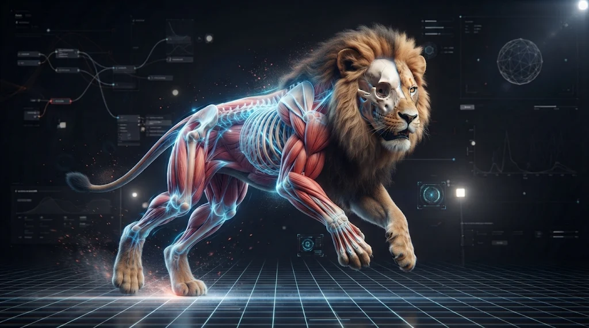

# Creatures (Sinew)

Rewild's world has animals in it. Chickens peck in the meadows, lions wander the desert, crows
circle overhead and tuna swim in the seas. They walk, run, look at the player, run away from
them, and keep their feet on the ground on a slope. You can place a creature in the editor, or let
the world spawn them in each biome. This page explains what the creature system does and how to
use it.

> **Where the name comes from.** _Sinew_ is the tissue that ties muscle to bone. Sinew was the
> milestone that gave creatures a body: a skeleton, animation and simple movement. That work is
> complete. This page is now the plain-English guide to what it gives you.

---

## The short version

- **Creatures come from Blender** as glTF files, with a skeleton and animation clips.
- **A creature is a template plus a preset.** The template says which model and clips it uses.
  The preset says how it moves and where it may live.
- **Clips are named by meaning**, such as `idle`, `walk`, `run` and `eat`, so code never needs to
  know a model's own clip names.
- **Walking and running blend by speed.** A chicken speeding up moves smoothly from walk to run,
  and its feet do not slide.
- **Creatures move on their own.** They wander near home, run from the player or run at them.
- **Each creature has a habitat**: land, water or air. A deer stops at the shore, a fish stays in
  its lake, and a bird stays in the sky.
- **Heads and feet react to the world.** A head turns to look at the player, and feet reach down
  to the ground on a slope.
- **Biomes spawn creatures**, alone or in groups. The same place always has the same animals.
- **Up to 100 creatures** are alive at once. Far ones animate less often, to save time.

---

## How a creature is made

A creature has three parts:

| Part         | What it is                                                                  | Where it lives                    |
| ------------ | --------------------------------------------------------------------------- | --------------------------------- |
| **Model**    | The `.glb` file: the mesh, the skeleton and the animation clips.            | `templates/geometries.json`       |
| **Template** | The asset you place. It names the model, the preset and how clips map.      | `templates/template-library.json` |
| **Preset**   | How it moves, how fast, where it may live, and whether it looks and plants. | `CreaturePresets.ts`              |

Many templates can share one preset, and every chicken shares one model. Each creature only owns
its own pose and its own movement.

### Adding a new creature

1. Export the model from Blender as a `.glb` (see [Blender conventions](#blender-conventions)).
2. Add it to `templates/geometries.json`:

   ```json
   "goat": { "type": "gltf", "url": "models/goat.glb" }
   ```

3. Add a preset for it to `CREATURE_PRESETS` in `CreaturePresets.ts` (see [Presets](#presets)).
4. Add a template to `templates/template-library.json` that names the model and the preset:

   ```json
   {
     "name": "goat",
     "type": "asset",
     "preset": "goat",
     "clips": { "idle": "Idle_Breathing", "eat": "Graze" },
     "clipSpeeds": { "walk": 0.9, "run": 6 },
     "bones": { "lookAt": ["Neck1", "Neck2", "Head"] },
     "resource": { "geometryId": "goat" }
   }
   ```

5. Place it in the editor, or add a spawn rule to a biome (see [Spawning](#spawning)).

A template with a `preset` must use a skinned model, or it fails to load. A skinned model with no
preset still animates, but stays where you put it.

---

## Blender conventions

- **One armature for each creature.**
- **Size it by scaling the armature object** in Object Mode. Do not apply the scale. Delete any
  scale keys on the object first, or the clip puts the old scale back on export.
- **Name clips by meaning** if you can: `idle`, `walk`, `run`, `eat`. Then the template needs no
  clip map.
- **Start every walk and run loop on the same foot**, for example the left foot down. This keeps
  the feet in step when walk and run blend.
- **Name the neck, head and leg bones** clearly. The template lists them, so the names do not need
  to match a pattern.

---

## Templates

A creature template is a normal asset template with these extra fields:

| Field         | What it does                                                                         |
| ------------- | ------------------------------------------------------------------------------------ |
| `preset`      | The name of the creature's preset. Makes the asset move on its own.                  |
| `clips`       | Maps a meaning to a clip name, only where they differ.                               |
| `locomotion`  | Named sets of walking clips. See [Locomotion sets](#locomotion-sets).                |
| `clipSpeeds`  | The ground speed, in m/s, each walking clip moves the body at.                       |
| `idleActions` | Meanings it plays now and then while it stands still, such as `look` or `scratch`.   |
| `bones`       | `lookAt`: the neck bones then the head. `legs`: each leg's bones, for foot planting. |

**Clip names.** When code asks for `idle`, the template's `clips` map is checked first. If it has no
entry, the clip called `idle` is used, and then `Idle` if no exact match exists. So a model whose
clips already have meaning names needs no map.

**Clip speeds.** A walk clip moves the feet at some real speed, for example 0.6 m/s for a chicken.
Set it in `clipSpeeds` so the blend can match it. Left out, walk is 1 m/s and run is 3 m/s.

---

## Animation

Each creature has an **animation controller**. It makes every animation choice. Movement code
tells it what it wants, and the controller decides which clips play and how much.

### Walking and running

The controller reads how fast the creature is moving over the ground, and blends `idle`, `walk`
and `run` to match.

- A chicken's walk is 0.6 m/s and its run is 2.5 m/s. Moving at 1.5 m/s, it plays about half walk
  and half run.
- Walk and run share one cycle, so the feet stay in step while they blend.
- A clip never plays much faster or slower to match the speed. The rate moves by at most 15%, only
  to stop the feet sliding.
- Standing still, it plays `idle`.

### Locomotion sets

A **locomotion set** is a different way of walking. There are three: `normal`, `flee` and
`injured`.

```json
"locomotion": {
  "normal":  { "idle": "idle", "walk": "walk", "run": "run" },
  "injured": { "idle": "idle-hurt", "walk": "limp" }
}
```

A set only lists what it changes. The `injured` set above has no `run`, so it uses the normal one.
A creature with no `injured` set walks normally when asked for it, so code can ask any creature for
any set. Changing set crossfades over a quarter of a second.

### Actions

An **action** is a clip played over walking, such as `eat`. It fades in, plays, and fades out when
it ends or is stopped.

### Idle variety

While a creature stands still, every 4 to 10 seconds it plays one of its `idleActions`. Moving
fades it out.

### Using the controller from code

Every skinned asset has one as `asset.animator`:

```ts
animator.play('eat'); // fade in an action, once
animator.play('eat', true); // loop it
animator.stop('eat'); // fade it out
animator.isPlaying('eat');
animator.setLocomotion('flee'); // crossfade to a locomotion set
animator.resolveClip('idle'); // the model's clip name for a meaning, or null
```

Never play `walk` or `run` as an action. Change the creature's speed, and the controller blends
them for you.

**Files to look at:** `AnimationController.ts`, `Animator.ts` (measures ground speed each frame).

---

## Movement

A creature moves by itself. It turns toward a goal at its turn rate and speeds up and slows down
smoothly. It does not use physics.

### Movement modes

A creature has one or more **modes**. Each frame, every mode says how much it wants control, and
the one that wants it most takes over.

| Mode       | What it does                                                                                                                     |
| ---------- | -------------------------------------------------------------------------------------------------------------------------------- |
| **Wander** | Walks to a point near home, waits there, then picks another. While it waits, it plays an action chosen by weight, such as `eat`. |
| **Evade**  | When the player comes inside `radius`, it runs away. Past `release`, it calms down and wanders again.                            |
| **Seek**   | When the player comes inside `radius`, it runs at them. Past `release`, it gives up.                                             |

Evade and Seek take control from Wander, so a chicken stops eating and runs. Each can switch to a
locomotion set while it is in control, for example `flee`.

A creature's **home** is where it was placed or spawned. A placed creature's `radius` property
changes how far it wanders.

### Writing a new mode

A mode implements `IMovementMode`:

```ts
score(system); // how much it wants control this frame; 0 never takes it
enter(system); // it just took control
exit(system); // it just lost control
update(dt, system); // set the goal: system.steerTo(x, z, speed) or system.halt()
serialize() / restore(state); // its state as plain JSON
```

A mode only sets a goal. It never moves the creature or plays walk clips itself. It can use
`system.animator` to play actions and change locomotion set.

**Files to look at:** `MovementSystem.ts`, `modes/Wander.ts`, `modes/Seek.ts`.

---

## Habitats

A **habitat** says where a creature may be. One question, "can it be here?", is asked when it
spawns, when Wander picks a point, and before every step.

| Habitat   | Where it may be                                                       |
| --------- | --------------------------------------------------------------------- |
| **Land**  | On the ground, below a slope limit, in water no deeper than it wades. |
| **Water** | Under the surface and above the bed, by a margin, in chosen waters.   |
| **Air**   | In a height band above the ground or the water.                       |

- **At the edge.** When the way ahead leaves the habitat, the creature tries turning 45° then 90°
  to either side, and walks along the edge. If no way works, it stops at the nearest point.
- **Heights.** Water and air creatures pick a height inside their range with each Wander point.
  Birds look ahead and climb before a hill.
- **Falling.** Land and water creatures fall. A chicken placed in the air drops to the ground, and
  a fish placed above a lake drops into it. Birds never fall.
- **The wrong place.** A land creature in deep water, or a fish on land, is **stranded**. It drops
  to the ground, plays `idle` and stays still until the world under it changes.
- **Too steep.** A land creature on a slope past its limit is not stranded. It keeps walking until
  it is back on good ground.

### Birds

A bird always flies. Its locomotion set puts `glide` and `flap` in the walk and run slots, so it
glides at cruise speed and flaps when it goes faster or climbs. It rolls into turns. With
`circle: true` on Wander, each point is further round home, so the bird circles.

**Files to look at:** `Habitat.ts`.

---

## Presets

A preset is a plain object in `CREATURE_PRESETS` in `CreaturePresets.ts`. This is the chicken:

```ts
chicken: {
  driver: 'clips',
  movement: {
    walkSpeed: 0.6,     // m/s
    runSpeed: 2.5,      // m/s
    turnRate: 4,        // radians per second
    acceleration: 6,    // m/s²
    modes: {
      wander: {
        radius: 6,      // metres from home
        wait: [2, 6],   // seconds at each point
        actions: [
          { meaning: 'eat', weight: 3 },
          { meaning: null, weight: 2 },  // just stand
          { meaning: 'rest', weight: 3 },
        ],
      },
      evade: { radius: 5, release: 8, locomotion: 'flee' },
    },
  },
  lookAt: { radius: 12, yawLimit: 1.75, pitchLimit: 0.9, smoothing: 0.18 },
  habitat: [
    { type: 'land', slope: { from: 35, to: 30 }, waterDepth: { from: 0.3, to: 0.2 } },
  ],
},
```

### Movement settings

| Setting        | What it does                                                          |
| -------------- | --------------------------------------------------------------------- |
| `walkSpeed`    | The speed it wanders at.                                              |
| `runSpeed`     | The speed it evades or seeks at.                                      |
| `turnRate`     | How fast it can turn, in radians a second.                            |
| `acceleration` | How fast it speeds up and slows down.                                 |
| `cruiseSpeed`  | It never slows below this. Use it for fish and birds that never stop. |
| `climbSpeed`   | How fast it changes height. Leave it out for creatures that walk.     |
| `bank`         | How far a bird rolls at its full turn rate, in radians.               |
| `modes`        | Which of `wander`, `evade` and `seek` it uses, and their settings.    |

### Habitat settings

Choose one entry for `habitat`:

```ts
{ type: 'land', slope: { from: 35, to: 30 }, waterDepth: { from: 0.3, to: 0.2 } }
{ type: 'water', bedMargin: 0.4, surfaceMargin: 1, waterTypes: ['lake'] }
{ type: 'air', band: [15, 30], lookAhead: 3 }
```

Land limits use the same `{ from, to }` bands as biome scatter rules. `slope: { from: 35, to: 30 }`
means "fine below 30°, not allowed past 35°". Land can also limit `height`, in world metres.
Water's `waterTypes` is optional; left out, any water will do.

---

## Looking and foot planting

These two corrections play on top of the clips, so a pecking chicken still pecks while it looks
at you.

### Look-at

The head and neck turn to look at the player when they come close. The head turns most and the
neck bones share the rest. If the player goes past the yaw or pitch limit, for example behind the
creature, it looks forward again. The turn is smoothed, so the head never snaps.

**How to use it.** List the neck bones then the head in the template's `bones.lookAt`, parent
first. Add `lookAt` to the preset: `radius` (metres), `yawLimit` and `pitchLimit` (radians) and
`smoothing` (seconds).

### Foot planting

Each foot reaches up or down to the ground under it, so feet touch the slope and no leg floats or
stretches. The body drops a little to keep every leg in reach. A creature with three or more legs
can also tilt its body with the slope.

**How to use it.** List each leg in the template's `bones.legs`, parent first. The first two
bones bend, the third is carried, and any more lead down to the foot:

```json
"legs": [
  ["Femur.L", "Tibia.L", "Metatarsal.L", "Foot.L"],
  ["Femur.R", "Tibia.R", "Metatarsal.R", "Foot.R"]
]
```

Add `footIK` to the preset: `smoothing` (seconds), `maxStep` (how far a foot may move, as a part
of the leg's reach), and optionally `pitch` and `roll` (how much the body tilts with the slope,
0 to 1).

Leave `lookAt` or `footIK` out of the preset, and the head or feet just follow the clips.

**Files to look at:** `HeadLook.ts`, `FootPlant.ts`, and the renderer's `LookAtLayer.ts` and
`FootIKLayer.ts`.

---

## Placing and spawning

### Placing in the editor

Place a creature like any other asset. Where you put it is its home. In the editor it plays
`idle` in place, so you can see it is alive. It only moves in the game.

### Spawning

A biome lists the creatures that live in it in `creatures`, next to `scatter`, in `Biomes.ts`:

```ts
creatures: [
  { creature: 'chicken', density: 0.3, group: [2, 5], spread: 5 },
  { creature: 'lioness', density: 0.03, group: [3, 5], spread: 8, drift: 0.4, roam: 60 },
],
```

| Field      | What it does                                                      |
| ---------- | ----------------------------------------------------------------- |
| `creature` | The creature's template name.                                     |
| `density`  | Groups for each hectare.                                          |
| `group`    | How many animals in a group, smallest and largest. Left out, one. |
| `spread`   | How far from the group's home, in metres, each animal starts.     |
| `drift`    | How fast the group's home moves, in m/s. Left out, it stays put.  |
| `roam`     | How far the home may drift from where it started, in metres.      |

- **The same every time.** The world seed and the chunk decide each group, so a meadow always has
  the same chickens.
- **Habitats apply.** A group only spawns where its creature may live, so you can put fish in any
  biome and they only appear in its water. Birds spawn in their height band.
- **Groups move together.** The animals in a group share one home. When the home drifts, they
  wander after it, so a pride moves across the desert as one.
- **Near the player only.** A group spawns when the player is within 120 m and despawns past
  150 m. No more than 100 spawned creatures are alive at once.

**Files to look at:** `SpawnPlanner.ts`, `CreatureSpawner.ts`, `HerdHome.ts`.

---

## Saving

| What                     | Saved?                                     |
| ------------------------ | ------------------------------------------ |
| Creatures you place      | Yes, with the level, like any asset.       |
| Creatures a biome spawns | Not needed. The seed makes them again.     |
| Where a creature walked  | No. Every creature starts at home on load. |

---

## Quality and performance

- **Far creatures animate less often.** Within 20 m they update every frame, within 40 m at
  30 times a second, and further away at 15.
- **Hidden creatures still move** but do not animate, unless a shadow can see them.
- **Look-at stops** past its radius, and **foot planting** stops past 30 m.
- **One draw for each model.** Every visible chicken draws in one go, and shadows use the same
  data.

The perf panel shows the time spent on poses as `creature poses` under `cpu`. Under `counts`,
`creatures` is how many are alive and `creatures posed` is how many animated this frame. See
[Debugger & Console Commands](../debug-commands.md#perf-panel).

---

## Debugger / console functions

Type these in the browser console.

| Command                                            | What it does                                                       |
| -------------------------------------------------- | ------------------------------------------------------------------ |
| `showSkinnedInstances('chicken', 20)`              | Shows a grid of a skinned model in front of the camera.            |
| `playSkinnedClip('Walk')`, `stopSkinnedClips()`    | Plays a clip on every shown instance, or fades back.               |
| `animateSkinned(1.5, {...})`                       | Runs the animation controller at a ground speed.                   |
| `skinnedLocomotion('injured')`                     | Crossfades the shown instances to a locomotion set.                |
| `skinnedAction('Idle2')`                           | Plays an action over walking.                                      |
| `skinnedInstancesInfo()`, `hideSkinnedInstances()` | Reports what the shown instances drew, or removes them.            |
| `showCreatureSpawns()`                             | The spawner's state, and the nearest planned groups and creatures. |
| `goToCreature(0, 'lioness')`                       | Moves the player next to the nearest live creature.                |

The commands are registered in `SkinnedDebugCommands.ts` and `CreatureDebugCommands.ts`. See
[Debugger & Console Commands](../debug-commands.md#creatures).

---

## Related docs

- [Terrain (Strata)](./strata.md): the biomes creatures spawn in.
- [Objects, Scatter & Foliage (Understory)](./understory.md): how models load, and the scatter
  rules spawn rules sit next to.
- [Water (Pelagic)](./pelagic.md): the lakes and seas fish live in.
- [Renderer](../renderer.md): how the render passes fit together.
- [Debugger & Console Commands](../debug-commands.md): all the other console commands.
