# Kelp

`type: kelp` grows kelp: stalks that rise from a holdfast on the bed, with ribbon blades and the gas
floats that hold them up. Giant kelp, bull kelp, sugar kelp and feather boa kelp are all this type
with different keys. So are seagrass and pondweed. See [Seagrass and pondweed](#seagrass-and-pondweed).

[Back to scatter-forge](README.md)

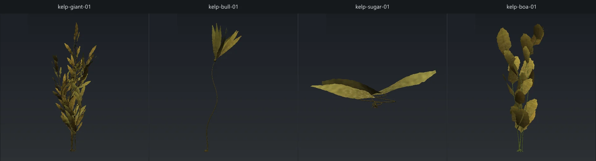

## How kelp is built

A kelp model has two pieces:

- **`stipe`**: the stalks, the holdfast and the floats. They are solid and use one tile.
- **`blade`**: the blades. They are cut-out cards on strips of one image, the same way a crown's
  fronds are. Each blade is three columns across, so its edges can ruffle while its midrib stays
  flat.

The type has no collider, no shadow, no impostor and no LOD tiers. Kelp is under water, so the player
swims through it and sees it from tens of metres at most.

## In the water

The layer that the tool writes for kelp is different from a land plant's layer in two ways.

- **It sways with the swell, not the wind.** The layer's `wind.medium` is `water`. The plant surges
  back and forth, and the tip trails the base, so the stalk bends in an S. The swell keeps moving on
  a calm day. `windAmplitude`, `windFrequency` and `windFlutter` tune it.
- **It folds at the surface.** With `surfaceCanopy`, the layer's `waterCeiling` is `surfaceMargin`.
  The part of the plant that would rise past that depth under the surface lies over along it instead,
  as far as it would have risen, in one direction per plant. So a tall kelp in shallow water forms a canopy, and the same model in
  deep water stands free.

See [In the game](in-game.md#water-plants).

## Seagrass and pondweed

Other water plants use the same keys. Both are green, with no holdfast and no floats.

- **Seagrass** is a tuft of narrow ribbons. `seagrass-01` has 18 stalks, each with one blade. It
  uses `bladeLayout: "single"`, so each stalk is too short to see. A `cardAspect` of `0.04` makes the
  blades narrow, and `midrib` and `corrugation` at `0` leave them plain. `seagrass-02` is the same
  plant at a `height` of `1.2`, so its stalks show under the blades. It uses the images of
  `seagrass-01`.
- **Pondweed** has small leaves up soft stems. `pondweed-01` has 5 thin stalks with 22 short blades
  up each one. It uses `bladeLayout: "along"`, with a `bladeLength` of `0.16` and a `cardAspect` of
  `0.32`.

All three set `surfaceCanopy`, with a small `surfaceMargin`, because they grow in water that is
shallower than they are tall.

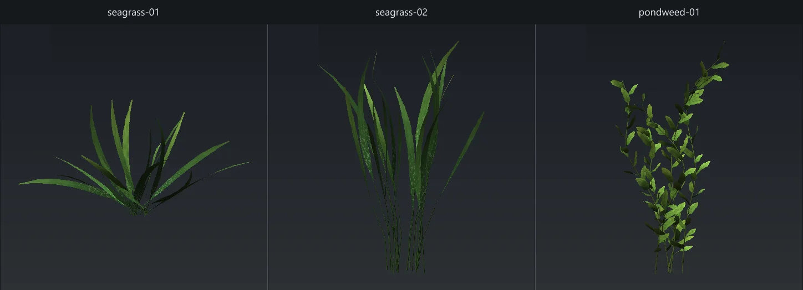

## The stalks

The comparison images start from `kelp-giant-01`, unless the label says `kelp-sugar-01`. The images
for the stalk shape draw the stalks alone, with the blades removed.

### `height`

Metres from the bed to the top of the tallest stalk and its blades.

Default: `4`. `kelp-giant-01` uses `4`.

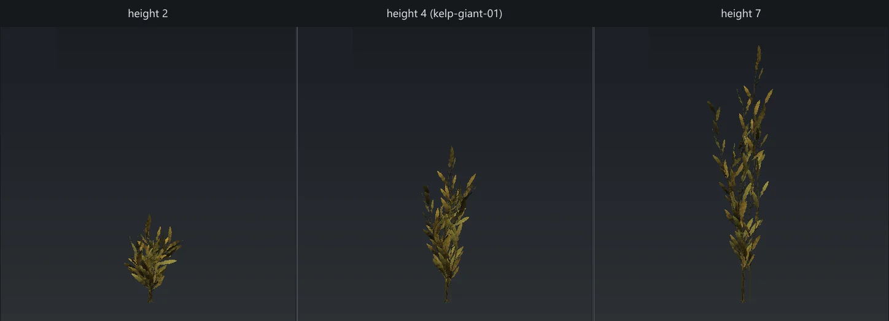

### `stipes`

How many stalks come out of one holdfast, 1 to 24. Giant kelp has many. Bull kelp has one.

Default: `6`. `kelp-giant-01` uses `7`.

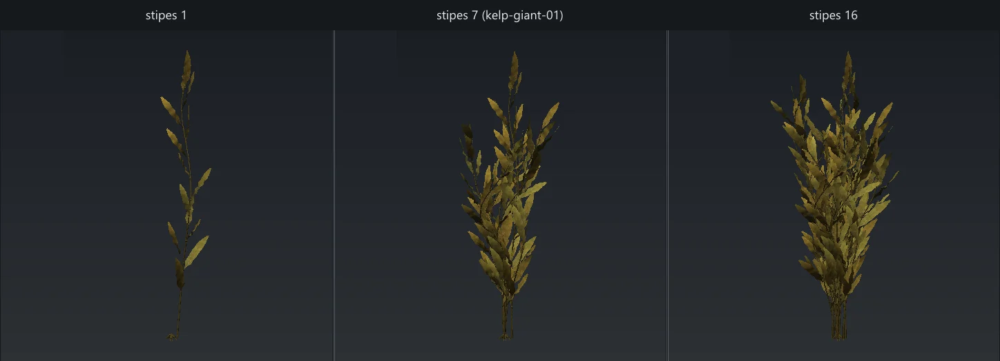

### `stipeSpread`

How far apart the stalk bases are, as a fraction of `height`.

Default: `0.03`.

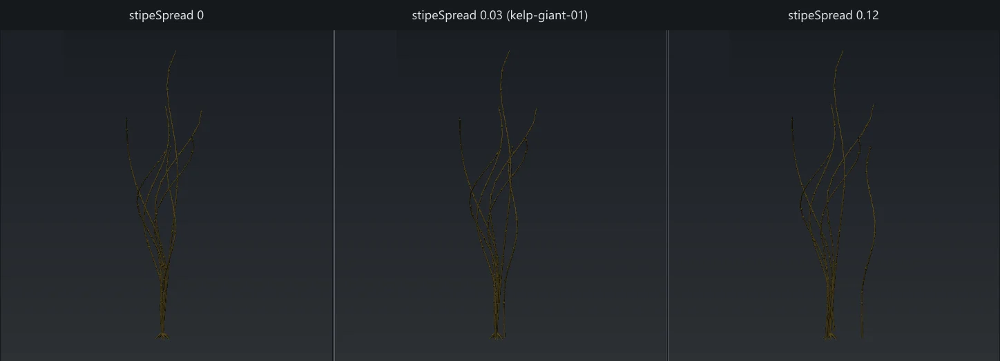

### `stipeRadius`

The stalk radius at the base, in metres.

Default: `0.012`.

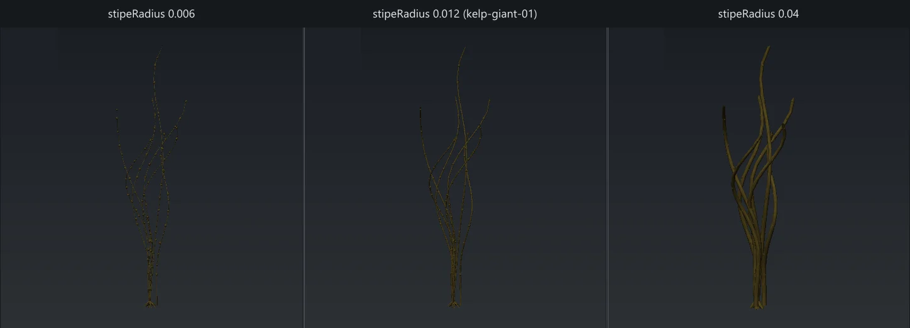

### `stipeTaper`

The stalk radius at the top, as a fraction of the base, 0 to 1.

Default: `0.6`.

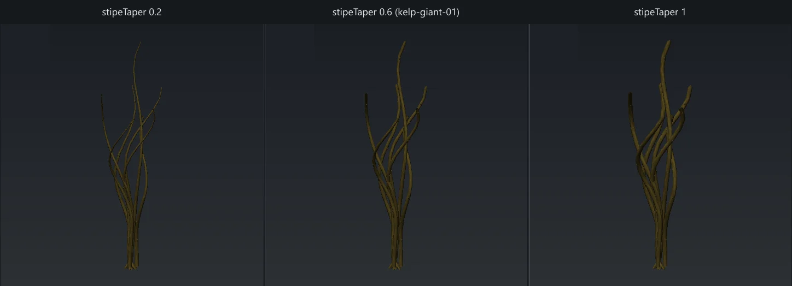

### `stipeLean`

How far the stalks lean out from upright by their tops, in degrees.

Default: `16`. `kelp-giant-01` uses `18`.

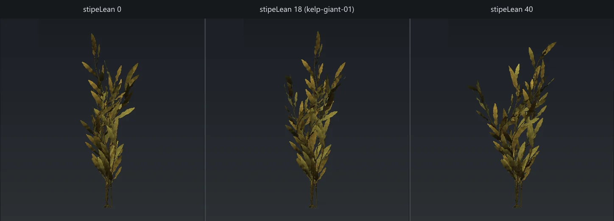

### `stipeWander`

How far a stalk curves away from a straight line by its top, in metres. This makes the stalk look soft, not like a pole.

Default: `0.45`. `kelp-giant-01` uses `0.5`.

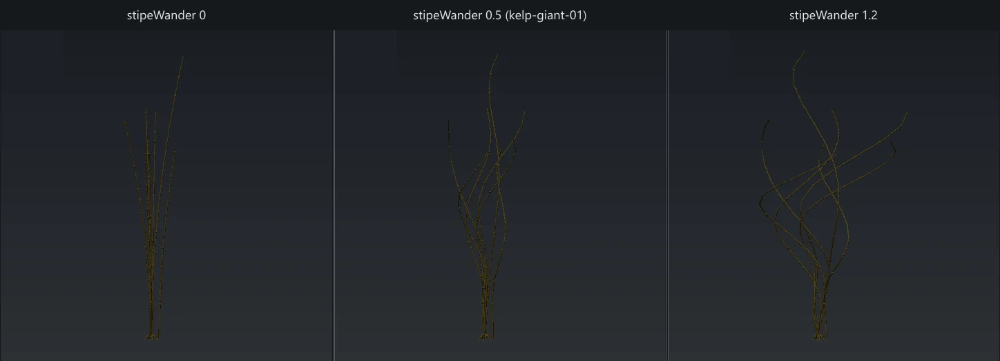

### `stipeHeights`

How much shorter than the tallest stalk the other stalks can be, 0 to 0.9. It makes the top uneven.

Default: `0.35`.

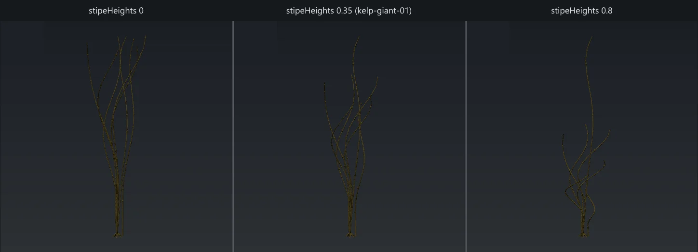

### `stipeSides`

How many sides a stalk has, 3 to 16.

Default: `6`.

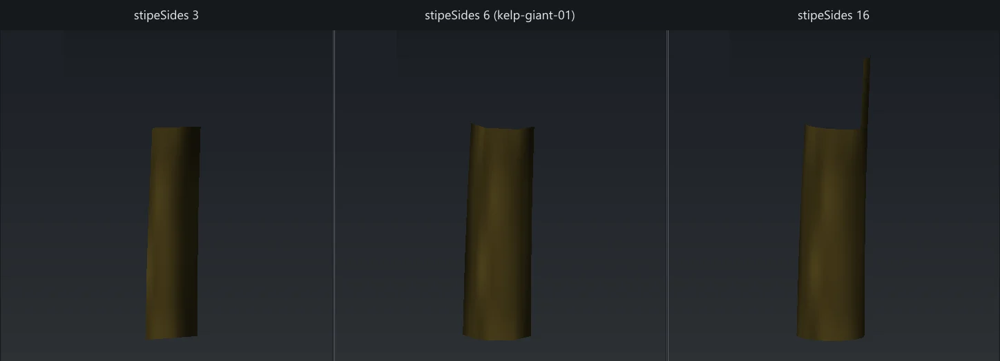

### `stipeSegments`

How many rings go up each stalk, 2 to 64. More rings make a smoother curve, a smoother sway and a smoother fold at the surface.

Default: `16`.

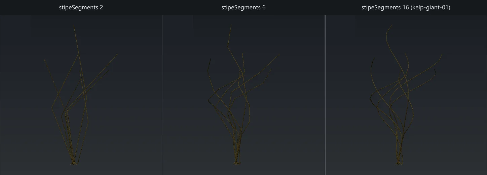

## The holdfast

The holdfast is the root-like grip on the rock: fingers that come out of a low mound and arch over
the bed. The images show the bottom of the model only.

### `holdfastRadius`

How far the fingers reach over the bed, in metres. `0` makes no holdfast.

Default: `0.12`.

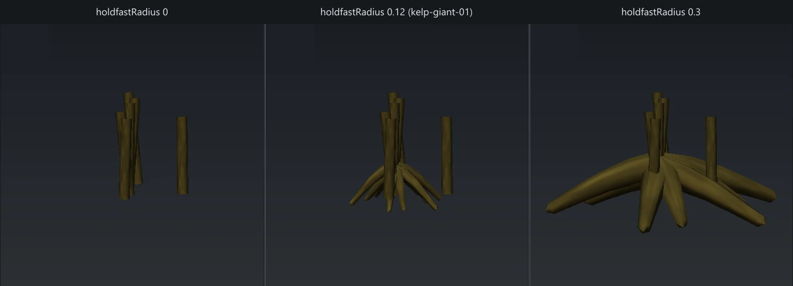

### `holdfastFingers`

How many fingers the holdfast has, 0 to 32.

Default: `9`.

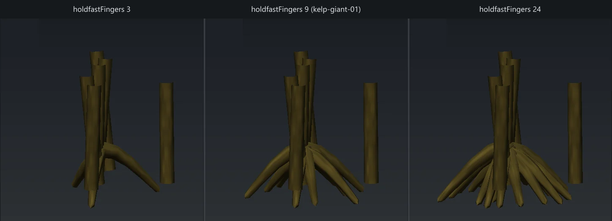

### `holdfastHeight`

How high the mound rises before the stalks start, in metres.

Default: `0.06`.

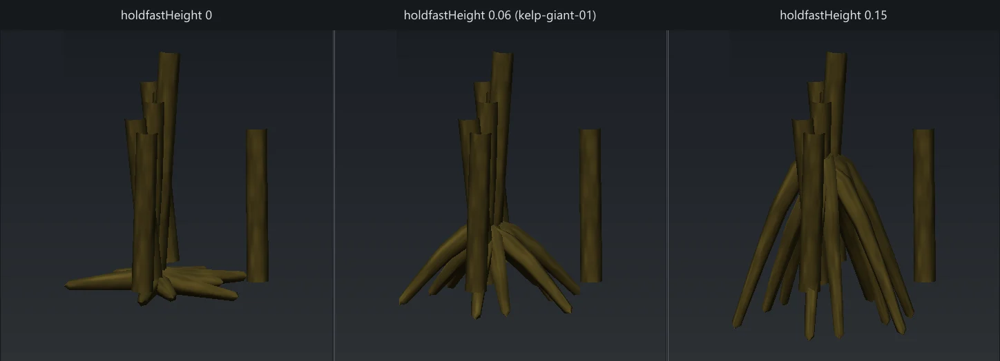

## The blades

The images after `bladeLayout` use one stalk, so each blade can be seen.

### `bladeLayout`

Where the blades come out of a stalk. `along` puts them up the stalk, like giant kelp. `tip` puts a tuft at the top, like bull kelp. `single` puts one wide blade on a short stalk, like sugar kelp.

Default: `along`.

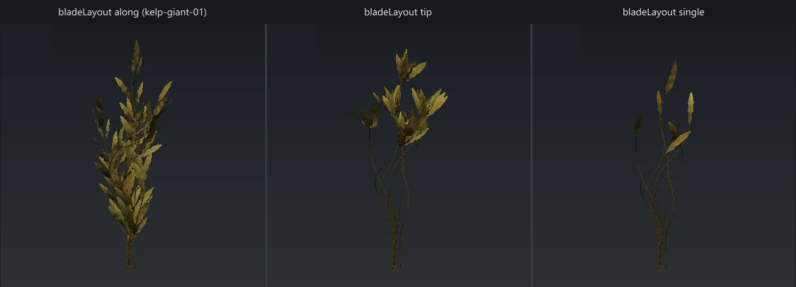

### `bladesPerStipe`

How many blades each stalk has at `along`, and how many are in the tuft at `tip`. `single` always has one.

Default: `12`. `kelp-giant-01` uses `14`.

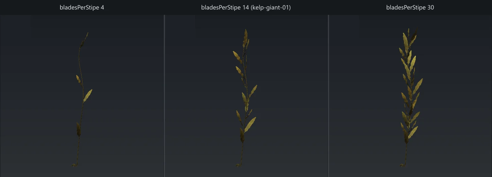

### `bladeSpan`

The part of the stalk, from the top down, that has blades. It is used at `along` only.

Default: `0.85`.

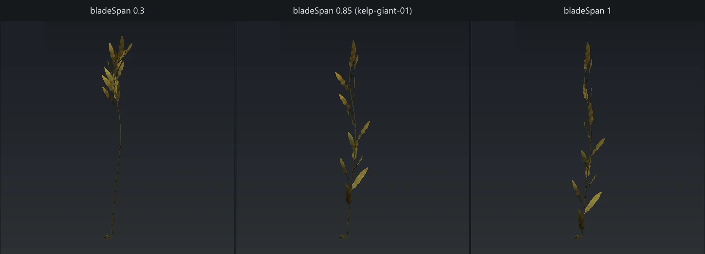

### `bladeLength`

The length of the longest blade, in metres. The other blades are a little shorter.

Default: `0.8`. `kelp-giant-01` uses `0.7`.

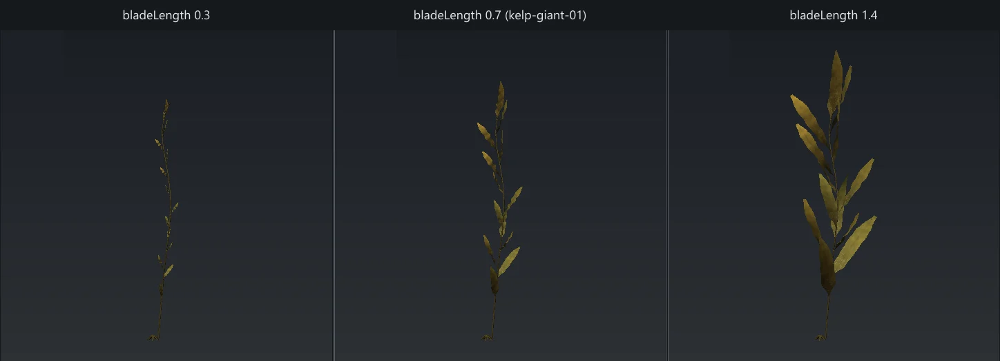

### `cardAspect`

The blade width as a fraction of its length. It also sets the shape of the blade's strip in the image, so changing it paints the image again.

Default: `0.18`.

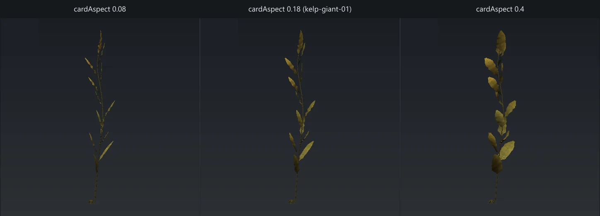

### `bladeWidth`

Makes the blade card wider or narrower without changing the image. Below `1` the art is squeezed. Above `1` it is spread.

Default: `1`.

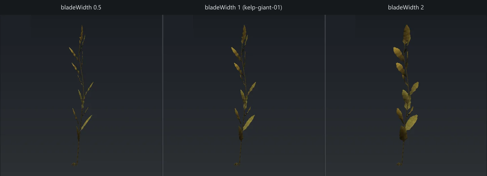

### `bladeAngle`

The angle at which each blade leaves the stalk, in degrees. Blades near the top stay closer to the stalk.

Default: `35`.

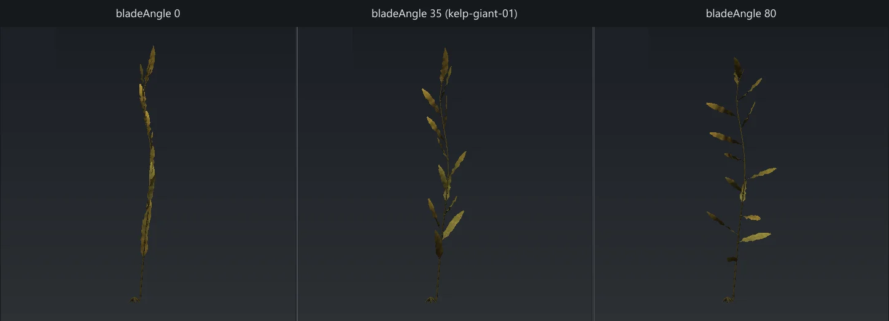

### `cardCurve`

How far a blade bends over its length, in degrees.

Default: `15`.

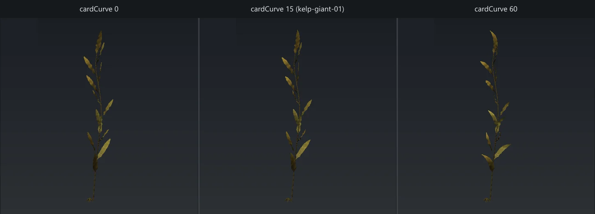

### `bladeTwist`

How far a blade twists about its length by its tip, in degrees. A twisted blade never looks like a flat card from the side.

Default: `70`.

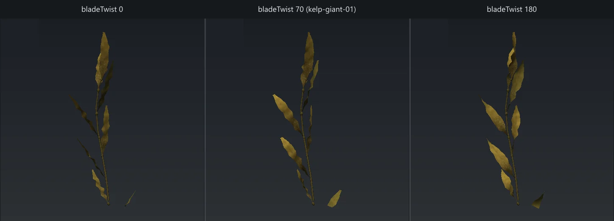

### `bladeRuffle`

How far the blade edges ruffle out of the blade's plane, in metres. The midrib stays flat.

Default: `0.02`. `kelp-sugar-01` uses `0.04`.

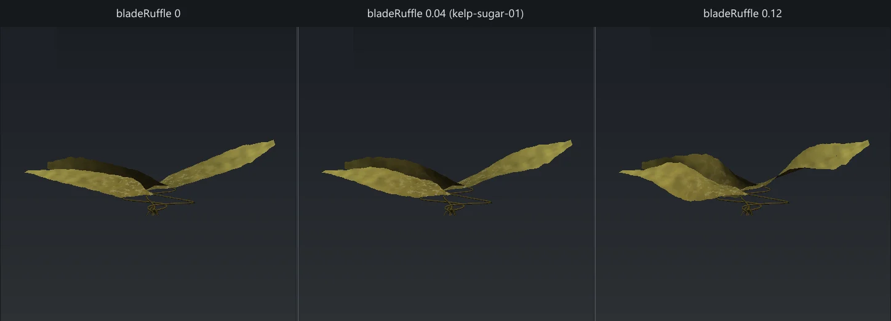

### `bladeRuffleWaves`

How many ruffles go along each edge, 0 to 32. The two edges ruffle in opposite directions.

Default: `6`. `kelp-sugar-01` uses `9`.

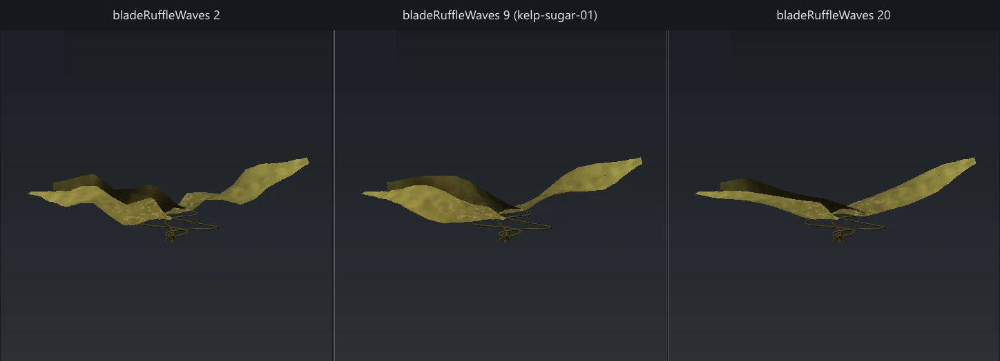

### `bladeAlternate`

Puts the blades left and right in turn up the stalk, instead of round it.

Default: `false`.

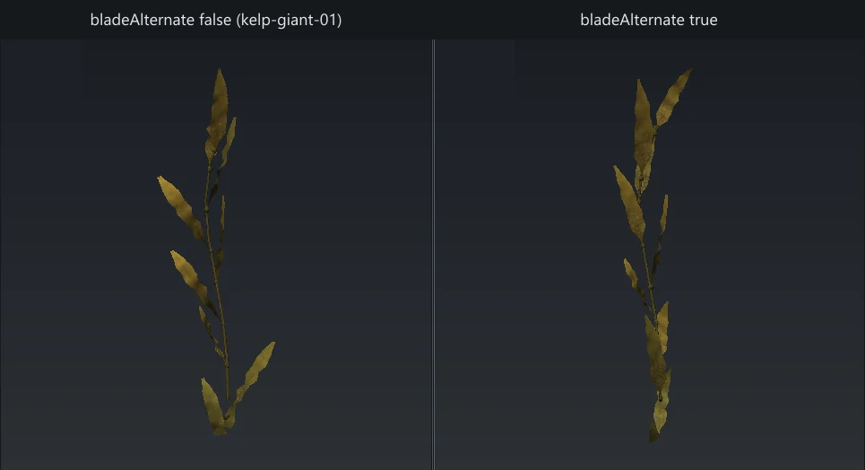

### `cardSegments`

How many segments go along each blade, 1 to 12. More segments make a smoother bend and a smoother sway.

Default: `10`.

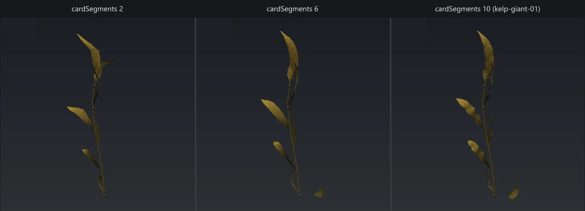

### `leafNormalMode`

How the blades are lit. See [Crowns](crown.md#leafnormalmode).

Default: `card`.

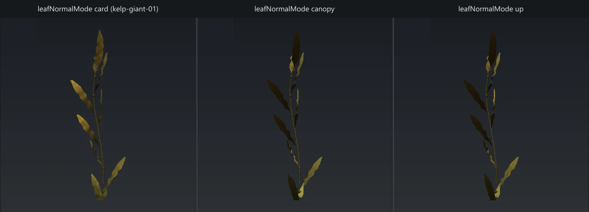

## The floats

The images show the top of one stalk.

### `bladders`

Which floats a stalk has. `blade` puts a small float at the base of every blade, like giant kelp. `tip` puts one bulb at the top of each stalk, like bull kelp. `none` puts none.

Default: `blade`.

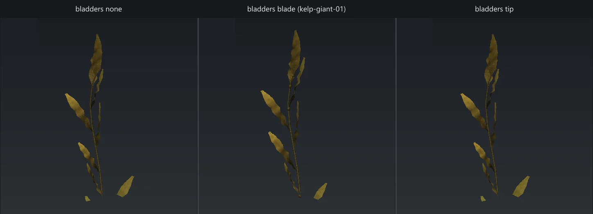

### `bladderRadius`

The float radius, in metres. A `tip` bulb wants several times the size of a blade float.

Default: `0.018`. `kelp-giant-01` uses `0.016`.

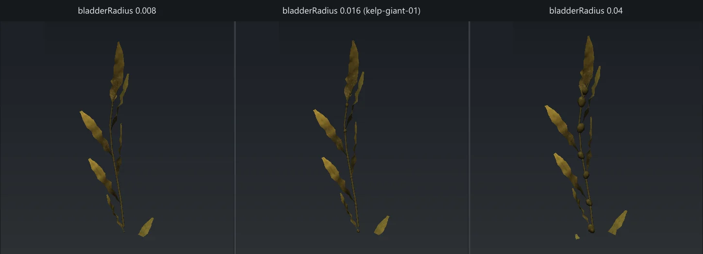

## The surface

| Key | Default | What it does |
| --- | ------- | ------------ |
| `surfaceCanopy` | `true` | Fold whatever reaches the surface along it. Turn it off for kelp that is always shorter than the water it grows in, such as sugar kelp. |
| `surfaceMargin` | `0.35` | Metres under the surface at rest that the canopy lies at. |

## Textures

The tool makes both images unless you give it art.

| Key | Default | What it does |
| --- | ------- | ------------ |
| `blades` | `[]` | The folders under `sources/kelp/` for blade art. `[]` makes the blades. See [Kelp art](#kelp-art). |
| `bark` | `[]` | The folder under `sources/bark/` for the stalk tile. `[]` makes it. |
| `textureSize` | `1024` | The size of the blade image in pixels. |
| `barkTextureSize`, `barkAspect` | | The size and shape of the stalk tile. See [Trees](tree.md). |

The keys below change the images the tool makes. They do nothing when you give it art. The images
show the made blade strips of `kelp-sugar-01`, except `stipeTint`.

### `kelpTint`

The colour of a made blade at its base, as a six digit hex colour.

Default: `#5b4a1f`. `kelp-sugar-01` uses `#6a5522`.

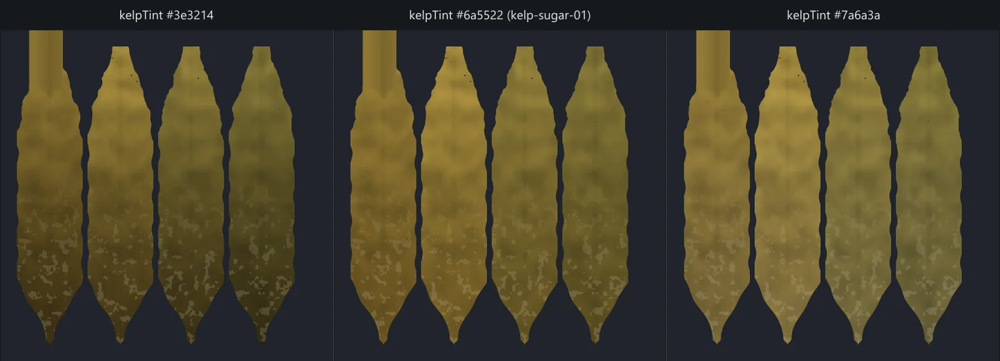

### `kelpTipTint`

The colour of a made blade at its tip. The blade fades from `kelpTint` to this.

Default: `#9c8232`. `kelp-sugar-01` uses `#a68d3e`.

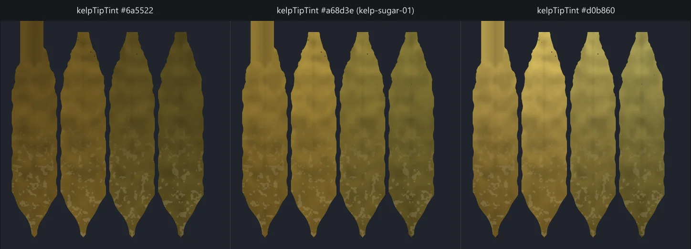

### `stipeTint`

The colour of the made stalks, floats and holdfast.

Default: `#4a3c19`.

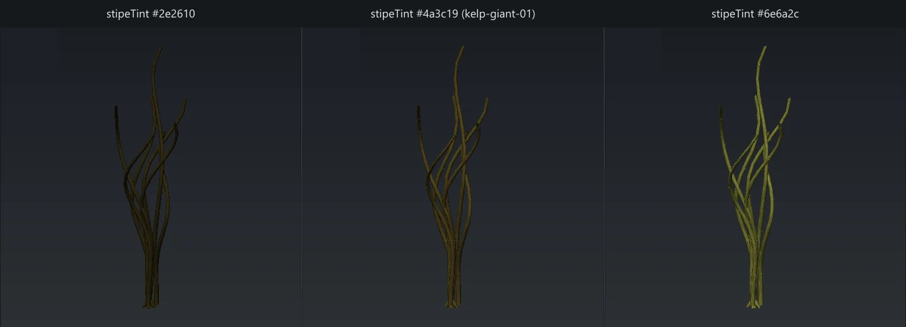

### `colourVariance`

How much made blades differ from one another in tone and hue, and how strong the patches on each are, 0 to 1.

Default: `0.15`.

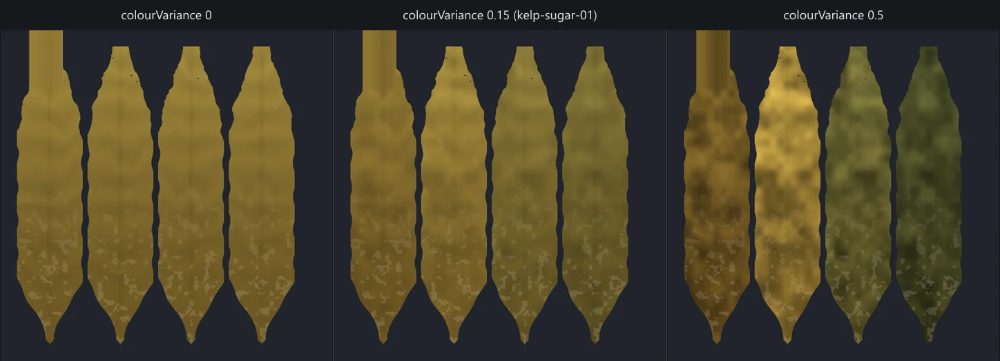

### `midrib`

How strong the line down the middle of a made blade is, 0 to 1. Use `0` for kelp that has none.

Default: `0.3`. `kelp-sugar-01` uses `0.15`.

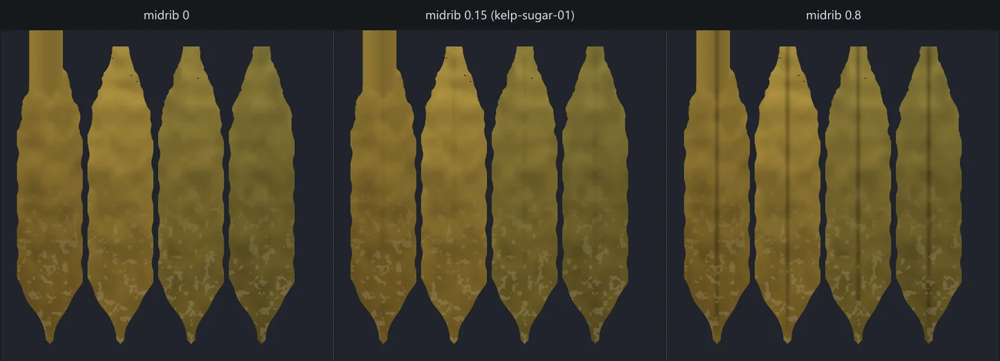

### `corrugation`

How strong the bumps across a made blade are, in its colour and its normal map, 0 to 1.

Default: `0.5`. `kelp-sugar-01` uses `0.8`.

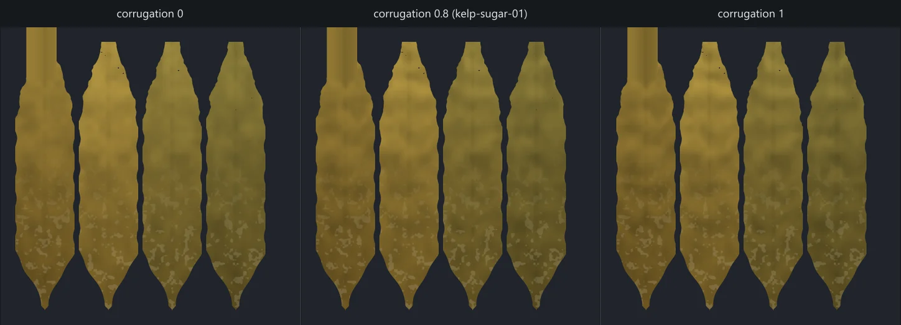

### `fray`

How torn the tips and edges of a made blade are, 0 to 1. High values also cut holes near the tip.

Default: `0.3`.

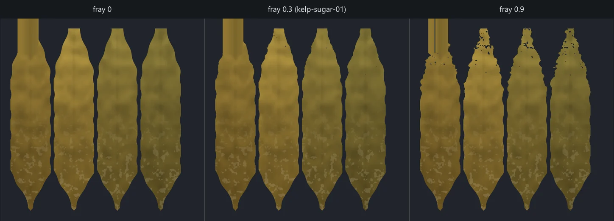

### `epiphytes`

How much pale crust grows on the older part of a made blade, near its base, 0 to 1.

Default: `0.2`.

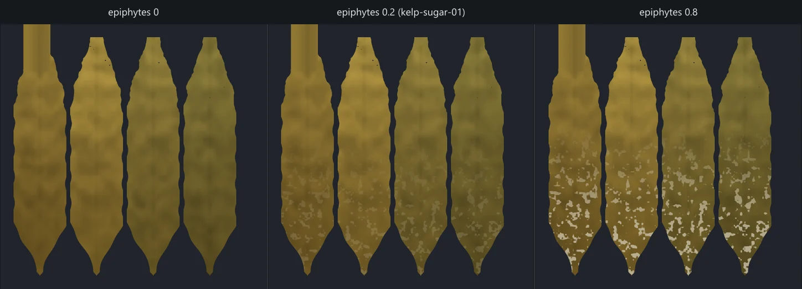

### Kelp art

Put each set of art in its own folder under `sources/kelp/`, the same way as frond art:

- One whole blade or frond in each picture. Put the base at the bottom-middle and the tip at the
  top-middle.
- Name the colour image `<name>-diff.webp`. The tool makes the other maps when they are missing. See
  [Authored art](authored-art.md).
- `source.json` gives the length: `{ "lengthMetres": 0.9 }`.
- Set `cardAspect` close to the width of the art over its length.

The `kelp-boa-01` template uses one picture of a whole feather boa frond, with its own stalk, blades
and floats, as each blade.

### Accents

Accents work as they do on a crown. Each stalk is a site, and `count` is the number of cards on each
stalk. `depth` is the part of the stalk, from the top down, that they come out of. Left out, it
follows the blades. See [Accents](accents.md).

## Other keys

The game keys work as on the other types. These defaults are different for kelp:

| Key | Default |
| --- | ------- |
| `cullDistance` | `120` |
| `castShadow` | `false`, and the layer never casts a shadow |
| `alignToNormal` | `0`: kelp grows straight up on any slope |
| `windAmplitude` | `1.2` |
| `windFrequency` | `0.18` |
| `windFlutter` | `0.2` |
| `bendCurve` | `1.8`: the bend gathers toward the top, so the stalk curves as it sways |
| `out` | `assets/shared/nature/kelp` |
